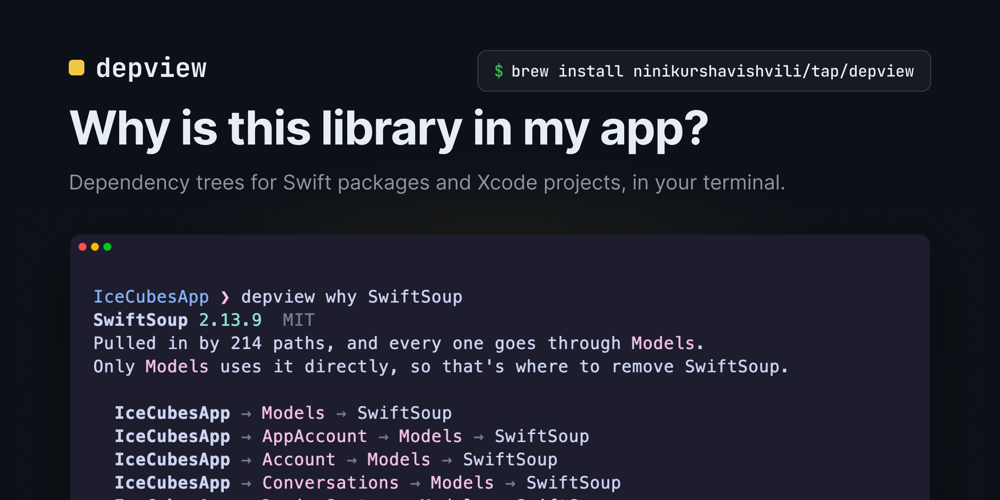
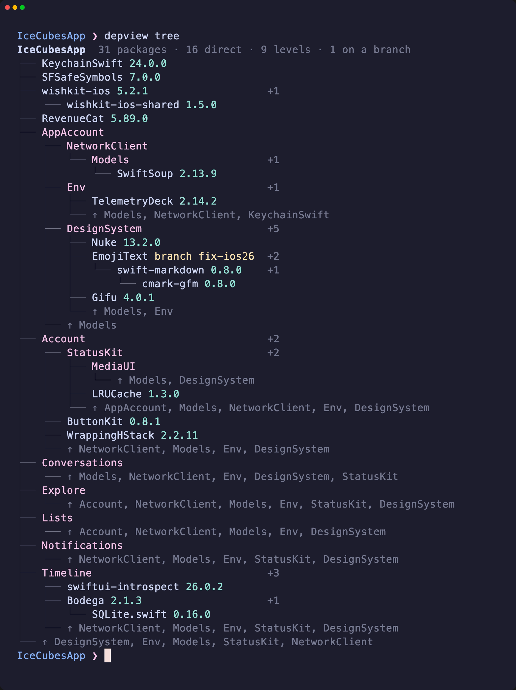
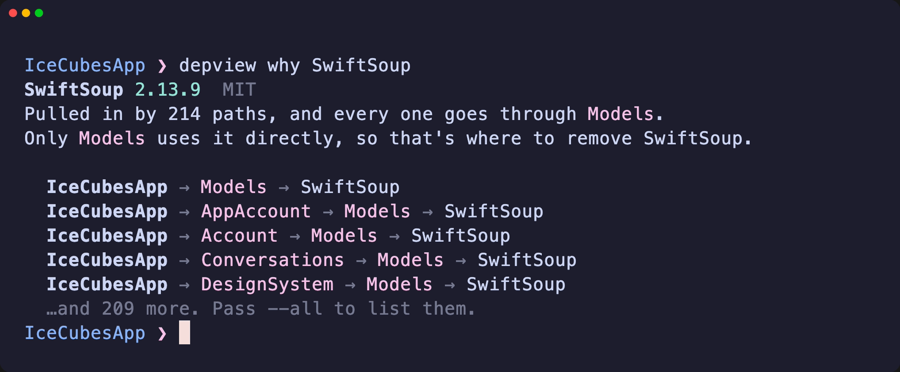
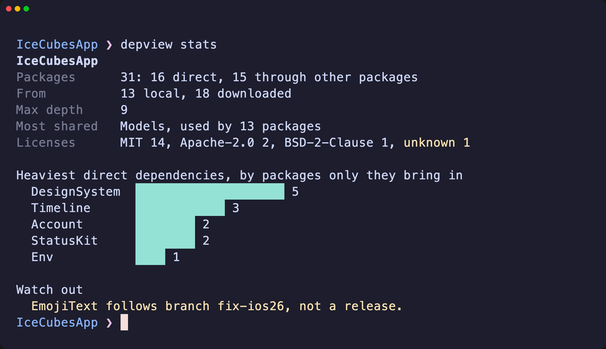
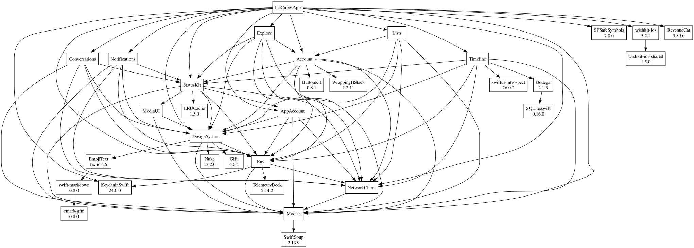

<p align="center">
  
</p>

<p align="center">
  <a href="https://github.com/ninikurshavishvili/depview/actions/workflows/ci.yml"></a>
  <a href="https://github.com/ninikurshavishvili/depview/tags"></a>
  <a href="https://github.com/ninikurshavishvili/homebrew-tap"></a>
  
  
  <a href="LICENSE"></a>
</p>

<p align="center">
  <a href="#install">Install</a> ·
  <a href="#usage">Usage</a> ·
  <a href="#xcode-projects">Xcode projects</a> ·
  <a href="#how-it-works">How it works</a> ·
  <a href="#contributing">Contributing</a>
</p>

Xcode shows your packages as a flat list. **depview** shows who depends on whom, for a Swift package or a whole Xcode app, and answers the question you actually have: *why is this package here, and where do I remove it?*

<p align="center">
  
</p>
<p align="center"><sub>Recorded with <a href="https://github.com/charmbracelet/vhs">vhs</a> on <a href="https://github.com/Dimillian/IceCubesApp">Ice Cubes</a>. The GIF skips the few seconds depview spends reading the Xcode project; the output is unedited.</sub></p>

## Features

- **Answers "why".** `depview why` finds the packages that every path to a dependency goes through, and who uses it directly, so you know where to remove it.
- **A tree you can read.** Each package is printed once, repeats fold into a `↑` line, and `+N` shows how many packages each dependency brings in on its own.
- **Xcode projects too.** It reads `.xcodeproj` and `.xcworkspace` files, local packages included, without building or changing anything.
- **A health check.** Licenses from each package's license file, the heaviest dependencies, and packages that follow a branch instead of a release.
- **Export.** Mermaid, Graphviz DOT or JSON, for docs, diagrams and CI.
- **Made for scripts.** JSON output, `NO_COLOR` support, clear exit codes, and every error comes with a hint.

## Install

```bash
brew install ninikurshavishvili/tap/depview
```

Homebrew builds depview on your Mac, so it needs Xcode 16 or later. depview runs on macOS 13 or later.

<details>
<summary>Build from source</summary>

```bash
git clone https://github.com/ninikurshavishvili/depview.git
cd depview
swift build -c release
.build/release/depview --help
```

</details>

<details>
<summary>Shell completion</summary>

depview prints completion scripts for zsh, bash and fish. For zsh:

```bash
mkdir -p ~/.zsh/completions
depview --generate-completion-script zsh > ~/.zsh/completions/_depview
```

Then add `fpath=(~/.zsh/completions $fpath)` to your `~/.zshrc`, before `compinit` runs. For fish:

```bash
depview --generate-completion-script fish > ~/.config/fish/completions/depview.fish
```

</details>

## Usage

Every command takes the project as its last argument: a folder with `Package.swift`, an `.xcodeproj` or an `.xcworkspace`. Without one, depview uses the current folder.

| Command | Answers |
|---|---|
| [`depview tree`](#tree) | What does my project depend on? |
| [`depview why <package>`](#why) | Why is this package here, and where do I remove it? |
| [`depview stats`](#stats) | How big is the graph, which licenses are in it, and what should I watch out for? |
| [`depview export`](#export) | Can I get the graph as a diagram or as JSON? |

### tree

Prints the dependency tree, with a summary next to the project's name. `depview` on its own does the same.

<p align="center">
  
</p>

- **Each package is shown once.** When it comes up again, it joins the `↑` line under that parent instead of being printed again.
- **`+N`** counts the packages that are there only because of that one: remove it, and they go too. DesignSystem's `+5` are Nuke, EmojiText and what it uses, and Gifu.
- **Colors:** your own local packages are magenta, releases cyan, and a package that follows a branch or a single commit is yellow, because it can change without a new version.

`--depth <n>` stops after n levels, `--no-versions` hides versions, and `--no-color` turns colors off. Colors are also off when the output goes to a file or a pipe, or when `NO_COLOR` is set.

### why

Answers why a package is in your project: how many paths pull it in, which packages every one of them goes through, and who uses it directly. Then it lists the shortest paths.

<p align="center">
  
</p>

It takes a package's name or identity, ignoring case, and suggests close matches when there's no such package. It lists the 5 shortest paths; `--all` lists every one.

### stats

<p align="center">
  
</p>

Licenses come from each downloaded package's license file, so depview needs no network for them. A file it doesn't recognize, or no file at all, counts as unknown; depview never guesses. It's a starting point for a license review, not legal advice.

`--json` prints the same numbers as JSON.

### export

Writes the graph as [Mermaid](https://mermaid.js.org) (the default), [DOT](https://graphviz.org) or JSON, to the terminal or to a file with `-o`.

```bash
depview export --format mermaid -o dependencies.mmd
depview export --format dot | dot -Tsvg -o dependencies.svg
depview export --format json
```

This is Ice Cubes' graph, drawn by Graphviz from `depview export --format dot`. Click it to open it full size.

<p align="center">
  <a href="Assets/graph.svg"></a>
</p>

The JSON lists every package once with its version, how that version was chosen (`release`, `branch` or `commit`), its URL, license and dependencies.

GitHub draws Mermaid diagrams in Markdown files, so you can paste the output into a README between ` ```mermaid ` fences.

## Xcode projects

For Swift packages, depview asks SwiftPM (`swift package show-dependencies`), which first downloads any packages it hasn't resolved yet. Xcode projects have no such command, so depview puts the graph together from:

- **project.pbxproj:** the packages your project adds, and the package folders in its navigator that a target links.
- **Package.resolved:** the version of each package.
- **DerivedData:** the packages Xcode downloaded. depview reads each one's `Package.swift` with `swift package dump-package` to find which packages it uses. Like SwiftPM, it leaves out dependencies that only tests or turned-off traits need.

So Xcode has to download the packages first. Open the project in Xcode once, or run:

```bash
xcodebuild -resolvePackageDependencies -project MyApp.xcodeproj
```

Until then, depview shows only your direct dependencies, with a warning. If you built with `xcodebuild -derivedDataPath <folder>`, pass the same folder with `--derived-data <folder>`.

For Xcode projects, depview doesn't download anything or change the project, so it works offline.

## How it works

- **Every path goes through:** depview builds the graph's [dominator tree](https://en.wikipedia.org/wiki/Dominator_(graph_theory)) with Cooper, Harvey and Kennedy's *A Simple, Fast Dominance Algorithm*, the same idea compilers use for control flow. A package's chain of dominators is the list of packages that every path from your project to it has to pass through.
- **`+N`:** the number of packages a dependency dominates, meaning the packages you can only reach through it.
- **Branches and commits:** SwiftPM reports a package pinned to a branch or a commit as `unspecified`, so depview reads the pin from `Package.resolved`.
- **Licenses:** depview looks for a `LICENSE`, `LICENCE` or `COPYING` file and matches the license's own wording. When a file contains several licenses, the one that comes first wins.

## Exit codes

| Code | Meaning |
|---|---|
| 0 | Success |
| 1 | Something to fix on your side, like a wrong path or an unknown package name |
| 2 | A tool depview runs failed, like `swift` |
| 64 | The command itself is wrong, like a missing argument |

Every error comes with a hint for fixing it.

## Coming next

- CocoaPods: reading `Podfile.lock`, so projects moving from CocoaPods to SwiftPM can see both.
- `depview browse`: an interactive screen to move through the tree, with details for the selected package.

## Contributing

Issues and pull requests are welcome. To build and test:

```bash
swift build
swift test
```

Rendering tests compare against snapshot files in `Tests/DepViewCoreTests/Fixtures`. To update one, delete the file and run `swift test` again: it writes the new snapshot and fails once, so you can check it.

The GIF and screenshots in this README are recorded with [vhs](https://github.com/charmbracelet/vhs) from the tapes in [`Assets/tapes`](Assets/tapes), so they always show real output.

## Acknowledgements

- [Ice Cubes](https://github.com/Dimillian/IceCubesApp) by Thomas Ricouard, the open-source Mastodon app used in every example here.
- [Swift Argument Parser](https://github.com/apple/swift-argument-parser) for the command line, [vhs](https://github.com/charmbracelet/vhs) for the recordings, and [Graphviz](https://graphviz.org) for drawing DOT files.

## License

MIT. See [LICENSE](LICENSE).
